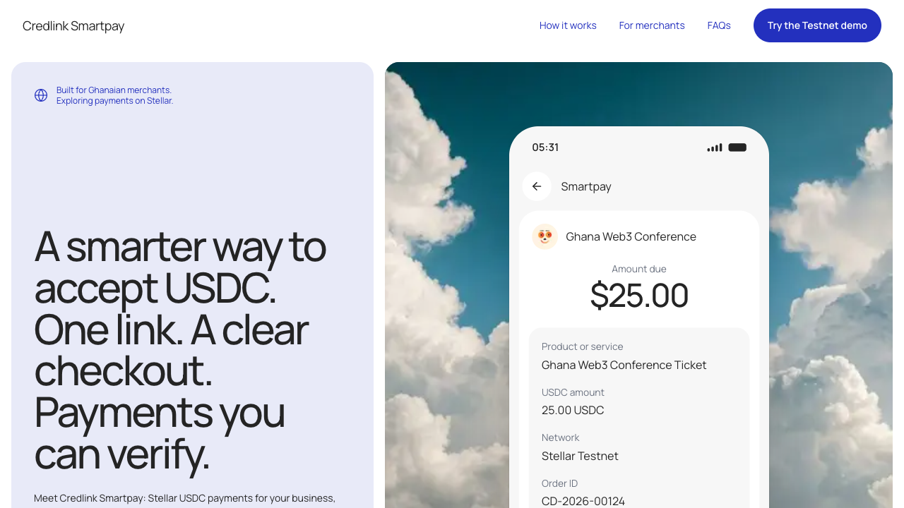

# Credlink Smartpay

**Accept USDC on Stellar with one link.**

Credlink Smartpay lets Ghanaian merchants request a payment in USDC, share a checkout link, and see the payment confirmed only after it has been verified on the Stellar network.

Live at [www.credlink.cc](https://www.credlink.cc). The MVP runs on **Stellar Testnet**: every payment uses test assets and no real money moves.



## What is Credlink?

Getting paid in digital dollars usually means sharing a wallet address, waiting for a screenshot, and checking a block explorer by hand. Credlink replaces that with a payment request the merchant creates in seconds and a checkout the customer can trust.

- **For merchants:** a dashboard to create payments, share checkout links and follow each payment's status live.
- **For customers:** a clear checkout that needs no Credlink account. Open the link, connect a Stellar wallet, approve the payment.
- **For both:** a payment is marked paid only when the transaction has been found and checked on Stellar, and every payment links to the Stellar explorer.

## How it works

1. **Set up.** The merchant signs up and sets a receiving wallet. Credlink can create one, or the merchant connects a wallet they already have.
2. **Create a payment.** The merchant enters a product or service, a USDC amount and an order reference. Customer name and email are optional.
3. **Share the link.** Credlink generates a checkout link. The order details travel with it, including the preview shown when the link is shared.
4. **The customer pays.** They review the checkout, connect a Stellar wallet and approve the payment in the wallet. On a phone they can pay from a wallet app instead.
5. **Credlink verifies.** The backend finds the transaction on Stellar and checks it against the payment. Only then do the checkout and the dashboard show it as paid.

## Features

| Area | What it does |
|---|---|
| Checkout | All 16 designed screens: review, wallet connection, approval, live status, and clear messages for a wrong network, a wrong asset, an expired link or a rejected payment |
| Wallets | Freighter in the browser; "Open in wallet app" with a SEP-7 link for phones; Albedo behind a flag |
| Test funds | "Get test USDC" on the checkout tops up a Testnet wallet so anyone can try a payment |
| Merchant sign-up | A managed wallet created for the merchant, or an existing one (Freighter, Albedo or a pasted public key) |
| Dashboard | Overview, payments list and details, create payment, Stellar USDC settings, and a toast when a payment turns paid |
| Installable app | Works as a PWA: opens on the dashboard, with offline and "new version" notices |
| Sharing and search | Each checkout link carries its own title, description and preview image; public pages have a sitemap and structured data |

## Who it is for

- **Event organisers** selling a conference ticket and sending the attendee a checkout link.
- **Designers and freelancers** requesting a deposit, with an order reference that keeps the brief and the payment together.
- **Consultants** sending a payment request and following its status before marking the work as paid.

## Built with

- [Next.js](https://nextjs.org) 16 (App Router) and React 19, written in TypeScript
- Tailwind CSS 4
- Stellar wallets through Freighter and Albedo
- TanStack Query for dashboard data
- GSAP and Motion for animation
- Vitest and Playwright for checks

This repository is the web app. The API and the background workers that verify payments live in a separate backend repository, [cedilink/credlink-backend](https://github.com/cedilink/credlink-backend).

## Getting started

You need Node.js 24 and a running Credlink backend.

```bash
npm install
cp .env.example .env.local    # set API_URL to the backend
npm run dev                   # http://localhost:3000
```

| Variable | Purpose |
|---|---|
| `API_URL` | Base address of the backend, for example `http://localhost:4000`. No trailing slash and no `/v1`. |
| `NEXT_PUBLIC_ALBEDO_ENABLED` | Set to `true` to offer Albedo in the checkout. Freighter is always available. |
| `NEXT_PUBLIC_SITE_URL` | Public address of the app, used for canonical links, the sitemap and social cards. |
| `NEXT_PUBLIC_GOOGLE_SITE_VERIFICATION`, `NEXT_PUBLIC_BING_SITE_VERIFICATION` | Optional ownership codes for each search console. |

The browser never calls the backend directly. Requests go to `/api/*` on this app and are forwarded, which keeps the merchant session cookie first-party.

### Trying a payment

1. Install [Freighter](https://www.freighter.app/) and switch it to **Testnet**.
2. Create a merchant account at `/signup`, then create a payment from the dashboard.
3. Open the checkout link, connect Freighter and use **Get test USDC** if the wallet is empty.
4. Approve the payment. The checkout and the dashboard update when it has been verified.

[docs/demo-runbook.md](docs/demo-runbook.md) walks through a full demo step by step.

## Project structure

| Route | What it is |
|---|---|
| `/` | Landing page with scroll-driven animation |
| `/signup`, `/login` | Merchant sign-up and sign-in |
| `/dashboard/*` | Merchant dashboard |
| `/c/[paymentId]` | Customer checkout |

| Path | Contents |
|---|---|
| `src/app/` | Routes, metadata, the manifest, `robots.ts` and `sitemap.ts` |
| `src/components/checkout/` | The checkout screens |
| `src/components/dashboard/` | Dashboard shell, shared UI and the live-update toasts |
| `src/components/landing/` | Landing sections, the pinned checkout scene and the animation layer |
| `src/lib/checkout/` | The checkout state machine, its wallet and API wiring, and SEP-7 links |
| `src/lib/wallets/` | One adapter per wallet behind a shared interface |
| `src/lib/api/` | The API client and types generated from the backend's OpenAPI document |
| `src/lib/pwa/`, `public/sw.js` | Install, offline and update handling, and the service worker |
| `scripts/` | Browser checks and the brand asset generator |

Notes for contributors:

- **Checkout.** `src/lib/checkout/machine.ts` has one state per designed screen. The success screen is reachable only when the backend reports the payment as paid.
- **Landing page.** Sections are plain markup that opt in to animation with data attributes (`data-split`, `data-fade`, `data-clip`, …). `landing-motion.tsx` owns the scroll-driven animation and documents each attribute. Nothing is animated for visitors who prefer reduced motion.
- **Service worker.** `public/sw.js` is written by hand. It never touches `/api/*` and never stores checkout or dashboard pages. Bump `VERSION` in that file to discard every cache.
- **Search engines.** The dashboard and checkouts are `noindex`, both in their metadata and as an `X-Robots-Tag` header set in `next.config.ts`.
- **Brand assets.** Icons, the favicon, the social card and the install screenshots are drawn by `node scripts/generate-brand-assets.mjs`. Rerun it when the brand changes.

The plan and the reasoning behind these choices are in [docs/plans/implementation-plan.md](docs/plans/implementation-plan.md).

## Checks

| Command | What it covers |
|---|---|
| `npm run typecheck`, `npm run lint` | Types and lint |
| `npm test` | The checkout state machine and SEP-7 links |
| `node scripts/landing-browser-check.mjs` | The landing page in Chrome: desktop, mobile and reduced motion |
| `node scripts/pwa-browser-check.mjs` | The manifest, the service worker and offline behaviour; needs `npm run build && npm start` |
| `node scripts/checkout-browser-check.mjs` | The checkout end to end against a running backend on Testnet |
| `node scripts/signup-browser-check.mjs` | Both sign-up routes, then a customer paying the new merchant |
| `node scripts/dashboard-browser-check.mjs` | The dashboard, including a live payment arriving; expects a freshly seeded database |

The checkout check replaces the Freighter extension, which cannot be automated, with a stand-in that signs with a Testnet customer key. Start the frontend with `NEXT_PUBLIC_TEST_WALLET=true` and point `FRONTEND_URL` and `API_URL` at the running servers. Never set that flag in production.

To cover a checkout expiring in front of the customer, start the backend with `PAYMENT_TTL_MINUTES=1` and run the same script with `EXPIRY_ONLY=true`.

CI runs the type check, lint, unit tests and a production build on every push to `main` and on pull requests.

## Working with the backend

`src/lib/api/schema.d.ts` is generated from the backend's `openapi.json`. After the API changes, with the backend checked out beside this repository as `cedlink-backend/`:

```bash
npm run api:types
```

## Status

Credlink Smartpay is an MVP on Stellar Testnet, built for Ghanaian merchants. It does not process real payments yet.
